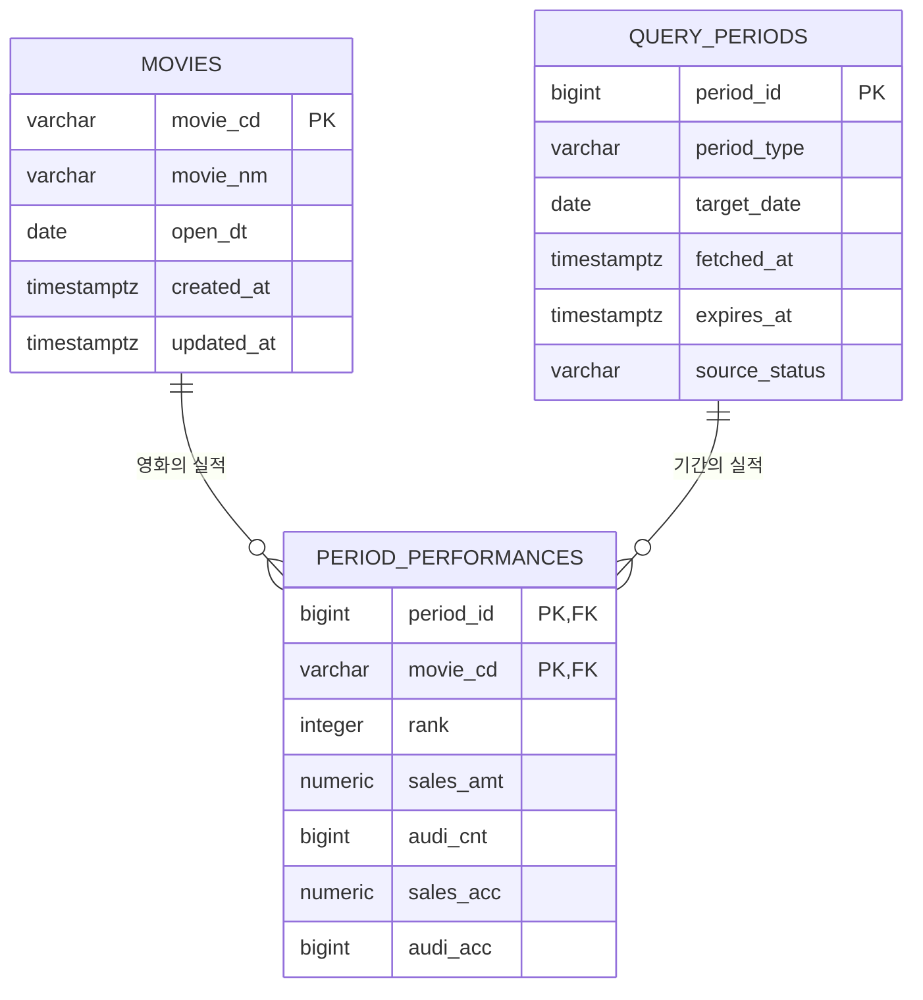

# 영화 박스오피스 데이터 모델 설계

## 1. 설계 목표 및 원칙

이 모델은 KOBIS의 일간·주간·주말 박스오피스 응답을 재사용 가능한 관계형 데이터로 저장하고, 목록 화면과 인사이트 화면의 조회를 지원한다.

- **중복 최소화:** 영화 자체의 정보는 한 번만 저장하고, 날짜·기간에 따라 달라지는 수치만 별도로 저장한다.
- **데이터 정확성:** KOBIS가 문자열로 전달하는 수치를 서버에서 숫자로 검증한 뒤 저장한다. 영화 코드만은 식별자이므로 문자열로 유지한다.
- **조회 일관성:** 하나의 기간에는 하나의 영화 실적만 존재하도록 복합 기본키를 둔다.
- **캐시 운영:** 조회 기간에는 KOBIS 수집·만료 정보를 함께 저장해 캐시 상태를 판단할 수 있게 한다.

## 2. 저장해야 할 데이터

KOBIS의 일간·주간·주말 응답을 정규화해 다음 세 범주로 나누어 저장한다. KOBIS는 숫자도 문자열로 반환할 수 있으므로, API 수신 직후 서버에서 검증한 정수/`numeric` 값만 데이터베이스에 저장한다.

| 범주 | 저장 항목 | 비고 |
| --- | --- | --- |
| 영화 정보 | 영화 코드, 영화명, 개봉일 | 영화 코드(`movieCd`)는 식별자이므로 문자열로 보존한다. |
| 조회 기간 | 기간 유형, 기준일 | 기간 유형은 `daily`, `weekly`, `weekend`이며, 기준일은 해당 KOBIS 조회에 사용한 날짜다. |
| 기간별 영화 실적 | 순위, 매출, 관객수, 누적 매출, 누적 관객수 | 특정 조회 기간 안에서 특정 영화가 기록한 성과다. 매출의 단위는 원, 관객수의 단위는 명이다. |

## 3. 하나의 표에 모두 저장할 때의 문제

예를 들어 모든 정보를 `box_office_all(period_type, target_date, movie_cd, movie_nm, open_dt, rank, sales_amt, audi_cnt, sales_acc, audi_acc)` 하나의 표에 저장한다고 가정한다. 한 영화가 여러 날짜·기간에 조회되면 영화 정보가 매 행에 반복된다.

| 이상 유형 | 발생 사례 | 문제 |
| --- | --- | --- |
| 삽입 이상 | 아직 박스오피스 실적이 없는 신규 영화를 미리 등록하려 한다. | 기간·순위·매출 같은 실적 값 없이는 영화 코드·이름·개봉일만 저장하기 어렵거나, 의미 없는 빈 값의 실적 행을 만들어야 한다. |
| 수정 이상 | 영화명 또는 개봉일을 정정해야 하는데 이 영화의 일간·주간·주말 실적 행이 여러 개 있다. | 모든 행을 빠짐없이 수정하지 않으면 같은 영화가 서로 다른 이름·개봉일을 갖는 불일치가 발생한다. |
| 삭제 이상 | 특정 날짜의 마지막 실적 행을 정리하거나 삭제한다. | 그 행에만 남아 있던 영화 정보까지 함께 사라져 영화 자체를 알 수 없게 된다. |

영화 정보와 조회 기간, 실적은 서로 다른 사실이다. 따라서 각각을 독립 테이블로 분리해 중복을 제거하고 관계로 연결한다.

## 4. 정규화된 테이블 설계

### 4.1 `movies` — 영화

| 컬럼 | 키/제약 | 타입 예시 | 설명 |
| --- | --- | --- | --- |
| `movie_cd` | PK | `varchar` | KOBIS `movieCd`. 숫자로 변환하지 않는 영화 식별자. |
| `movie_nm` | NOT NULL | `varchar` | KOBIS `movieNm`. |
| `open_dt` | NULL 허용 | `date` | KOBIS `openDt`를 검증·변환한 개봉일. |
| `created_at` | NOT NULL | `timestamptz` | 최초 저장 시각. |
| `updated_at` | NOT NULL | `timestamptz` | 마지막 갱신 시각. |

### 4.2 `query_periods` — 조회 기간

| 컬럼 | 키/제약 | 타입 예시 | 설명 |
| --- | --- | --- | --- |
| `period_id` | PK | `bigint` 또는 `uuid` | 내부 조회 기간 식별자. |
| `period_type` | NOT NULL, CHECK | `varchar` | `daily`, `weekly`, `weekend` 중 하나. |
| `target_date` | NOT NULL | `date` | KOBIS 요청 기준일. |
| `fetched_at` | NOT NULL | `timestamptz` | KOBIS에서 성공적으로 받은 시각. |
| `expires_at` | NOT NULL | `timestamptz` | 캐시 만료 시각. |
| `source_status` | NOT NULL, CHECK | `varchar` | `success` 또는 `empty`. 빈 정상 응답도 캐시할 수 있다. |
| `(period_type, target_date)` | UNIQUE | - | 같은 기간 유형·기준일의 중복 캐시를 막는다. |

### 4.3 `period_performances` — 기간별 영화 실적

| 컬럼 | 키/제약 | 타입 예시 | 설명 |
| --- | --- | --- | --- |
| `period_id` | PK, FK → `query_periods.period_id` | `bigint` 또는 `uuid` | 어떤 조회 기간의 실적인지 가리킨다. |
| `movie_cd` | PK, FK → `movies.movie_cd` | `varchar` | 어떤 영화의 실적인지 가리킨다. |
| `rank` | NOT NULL, CHECK (`rank > 0`) | `integer` | KOBIS `rank`를 숫자로 변환한 순위. |
| `sales_amt` | NOT NULL, CHECK (`sales_amt >= 0`) | `numeric(18,0)` | KOBIS `salesAmt`를 숫자로 변환한 매출(원). |
| `audi_cnt` | NOT NULL, CHECK (`audi_cnt >= 0`) | `bigint` | KOBIS `audiCnt`를 숫자로 변환한 관객수(명). |
| `sales_acc` | NOT NULL, CHECK (`sales_acc >= 0`) | `numeric(18,0)` | KOBIS `salesAcc`를 숫자로 변환한 누적 매출(원). |
| `audi_acc` | NOT NULL, CHECK (`audi_acc >= 0`) | `bigint` | KOBIS `audiAcc`를 숫자로 변환한 누적 관객수(명). |

`period_performances`의 복합 기본키는 **`(period_id, movie_cd)`**다. 즉, 하나의 조회 기간에 같은 영화의 실적은 한 번만 존재한다. 조회 화면의 순위 정렬을 위해 `period_performances(period_id, rank)` 인덱스를 추가한다.

## 5. 테이블 관계 (ERD)



관계 해석:

- 영화 1개는 여러 조회 기간에서 여러 실적 행을 가질 수 있다(1:N).
- 조회 기간 1개는 여러 영화의 실적 행을 가질 수 있다(1:N).
- 따라서 영화와 조회 기간은 `period_performances`를 통해 N:M 관계를 이룬다.

## 6. 예시 데이터 및 JOIN 조회

아래는 영화 2개와 일간 기준 날짜 3일의 가상 예시다. 금액은 원, 관객수는 명이다.

### `movies`

| movie_cd | movie_nm | open_dt |
| --- | --- | --- |
| `20260001` | 별빛 탐정단 | 2026-10-20 |
| `20260002` | 여름의 끝 | 2026-10-22 |

### `query_periods`

| period_id | period_type | target_date | source_status |
| --- | --- | --- | --- |
| 101 | daily | 2026-10-22 | success |
| 102 | daily | 2026-10-23 | success |
| 103 | daily | 2026-10-24 | success |

### `period_performances`

| period_id | movie_cd | rank | sales_amt | audi_cnt | sales_acc | audi_acc |
| --- | --- | --- | ---: | ---: | ---: | ---: |
| 101 | `20260001` | 1 | 12000000 | 1200 | 36000000 | 3600 |
| 101 | `20260002` | 2 | 8000000 | 800 | 8000000 | 800 |
| 102 | `20260001` | 1 | 10000000 | 1000 | 46000000 | 4600 |
| 102 | `20260002` | 2 | 9000000 | 900 | 17000000 | 1700 |
| 103 | `20260001` | 2 | 7000000 | 700 | 53000000 | 5300 |
| 103 | `20260002` | 1 | 11000000 | 1100 | 28000000 | 2800 |

### 목록 화면용 JOIN 예시

2026-10-23의 일간 박스오피스 목록은 조회 기간 → 기간별 실적 → 영화 순으로 JOIN한다.

```sql
SELECT
  p.target_date AS query_date,
  p.period_type,
  pp.rank,
  m.movie_cd,
  m.movie_nm,
  m.open_dt,
  pp.sales_amt,
  pp.audi_cnt,
  pp.sales_acc,
  pp.audi_acc
FROM query_periods AS p
JOIN period_performances AS pp
  ON pp.period_id = p.period_id
JOIN movies AS m
  ON m.movie_cd = pp.movie_cd
WHERE p.period_type = 'daily'
  AND p.target_date = DATE '2026-10-23'
ORDER BY pp.rank ASC;
```

조회 결과는 다음처럼 화면에 표시할 수 있다.

| 순위 | 영화명 | 개봉일 | 매출 | 관객수 | 누적 관객수 |
| ---: | --- | --- | ---: | ---: | ---: |
| 1 | 별빛 탐정단 | 2026-10-20 | 10,000,000원 | 1,000명 | 4,600명 |
| 2 | 여름의 끝 | 2026-10-22 | 9,000,000원 | 900명 | 1,700명 |

### 3일 매출 추이용 JOIN·집계 예시

인사이트 화면에서 특정 영화의 최근 3일 추이는 같은 JOIN을 사용하되, 날짜별로 실적을 정렬한다.

```sql
SELECT
  p.target_date,
  m.movie_nm,
  pp.sales_amt,
  pp.audi_cnt,
  pp.rank
FROM query_periods AS p
JOIN period_performances AS pp
  ON pp.period_id = p.period_id
JOIN movies AS m
  ON m.movie_cd = pp.movie_cd
WHERE p.period_type = 'daily'
  AND p.target_date BETWEEN DATE '2026-10-22' AND DATE '2026-10-24'
  AND m.movie_cd = '20260001'
ORDER BY p.target_date ASC;
```

이 구조에서는 영화명·개봉일을 한 곳에서만 관리하고, 일간·주간·주말의 순위와 수치는 기간별 실적에만 저장한다.
